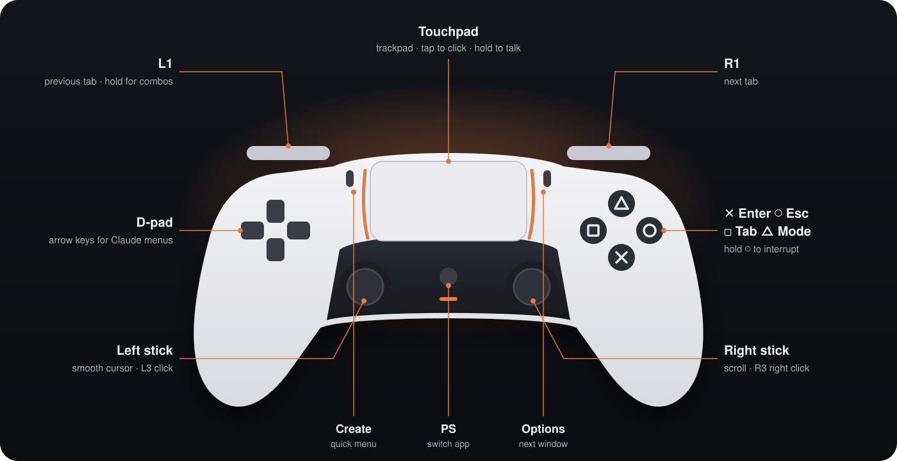

<div align="center">

# 🎮 PadPilot

### Drive Claude Code, your editor and your whole Mac from a DualSense controller.

Lean back. Approve, steer, talk to and switch between your AI agents from the couch.
<br>
Native, tiny, no drivers, no subscription.

<br>


<br>



<br>

**[Install in 60 seconds](#-install)** · **[Controls](#-controls)** · **[Configure](#%EF%B8%8F-configure)** · **[How it works](#-how-it-works)**

</div>

---

## ✨ Why PadPilot

Agentic coding is mostly **waiting, reading and saying yes**. You don't need a keyboard for that.
PadPilot turns a PS5 DualSense into a remote for Claude Code: arrows and Enter for its menus,
a held touchpad for voice, a buzz in your hands when an agent needs you, and a quick menu for
every slash command you actually use. Then it keeps going and runs the rest of your Mac too.

<table>
<tr>
<td width="33%" valign="top">

### 🔔 Agents tap you on the shoulder
The light bar **pulses red and rumbles** when Claude asks for permission, and **flashes green** when it finishes. Walk away, come back when it buzzes.

</td>
<td width="33%" valign="top">

### 🎙️ Talk instead of type
**Hold the touchpad** to use Claude's push-to-talk. Anywhere else, hold it and PadPilot types what you say into whatever field has focus.

</td>
<td width="33%" valign="top">

### ⚡ Quick menu
Tap **Create** for an on-screen menu: approve, reject, interrupt, `/clear`, `/compact`, `/model`, `/resume`, rewind and more. D-pad to pick, ✕ to fire.

</td>
</tr>
<tr>
<td valign="top">

### 🖱️ A real trackpad
One finger moves the cursor, **tap to click**, two fingers scroll. Triggers are left and right click. Plus a smooth stick cursor and **gyro aiming** (hold R1 and tilt).

</td>
<td valign="top">

### 🪟 Spaces, tabs and windows
Two-finger swipes on the touchpad switch desktops, L1 / R1 flip tabs in Zed, Chrome and Terminal, Options cycles windows. Your Mac, from the couch.

</td>
<td valign="top">

### 🧩 Combos and per-app maps
Hold L1 for **copy, paste, undo, clear all, backspace** and **screenshot to clipboard**. Every button can do something different per app.

</td>
</tr>
</table>

Hold **Create** any time and an on-screen cheat sheet shows what every button does **in the app you are in right now**.

A **menu bar icon** shows the controller battery (⚡ while charging) with pause, config and log one click away, and you get a buzz when the battery drops to 15%.

---

## 🚀 Install

```bash
git clone https://github.com/charanjit-singh/padpilot.git
cd padpilot
./build.sh            # builds ~/Applications/PadPilot.app and starts it at login
./install-hooks.sh    # optional: rumble + light when Claude Code needs you
```

Then:

1. **Grant Accessibility** when macOS asks (System Settings → Privacy & Security → Accessibility → PadPilot **on**). This is what lets it press keys for you.
2. **Pair the controller over Bluetooth**: hold **Create + PS** for 5 seconds until the light double-blinks, then click Connect in System Settings → Bluetooth.
3. The light bar turns **orange**. You're flying. 🛫

> Needs macOS 13+ and the Xcode command line tools (`xcode-select --install`). No other dependencies.

---

## 🎮 Controls

### Everywhere

| Button | Action |
|---|---|
| **D-pad** | Arrow keys (auto-repeat while held) |
| **✕ / ○** | Enter / Esc |
| **□ / △** | Tab / Shift+Tab |
| **L1 / R1** | Previous / next tab · *hold R1:* gyro aim |
| **L2 / R2** | Left click (hold to drag) / right click |
| **Options** | Next window of the same app · *hold:* switch app |
| **Create** | Quick menu · *hold:* controls cheat sheet |
| **PS** | Switch app · *hold:* pause PadPilot |
| **Touchpad** | Trackpad · tap to click · two fingers scroll · **two-finger swipe ← → switches desktop** · *press and hold:* speak and type |
| **Left stick** | Cursor |
| **Right stick** | Scroll |

### In Claude Code (Terminal / Zed)

| Button | Action |
|---|---|
| **Hold touchpad** | Claude voice push-to-talk, then ✕ to send |
| **Hold ○** | Interrupt (Ctrl+C) |
| **Hold △** | Rewind (Esc Esc) |
| **Hold □** | Search history (Ctrl+R) |
| **Hold ✕** | Transcript (Ctrl+O) |

### Combos: hold L1, then press

| Combo | Claude Code | Everywhere else |
|---|---|---|
| **L1 + □** | Copy | Copy |
| **L1 + △** | Paste | Paste |
| **L1 + ✕** | Screenshot area → clipboard | Screenshot area → clipboard |
| **L1 + ○** | Screenshot screen → clipboard | Screenshot screen → clipboard |
| **L1 + ←** | Backspace (repeats) | Backspace (repeats) |
| **L1 + ↓** | Clear prompt | Clear all |
| **L1 + ↑** | Restore cleared text | Undo |
| **L1 + →** |  | Redo |

L1 on its own still flips to the previous tab when released.

### Canned replies: hold Options, then press (Claude Code)

| Combo | Sends (then Enter) |
|---|---|
| **Options + ↑** | continue |
| **Options + →** | yes, go with your recommendation |
| **Options + ←** | run the tests and fix any failures |
| **Options + ↓** | stop and summarise what you've done so far |
| **Options + ✕ / ○** | yes / no |

Edit the texts in the config (`"options+up": "say:continue"`). Options alone still cycles windows.

### Light bar

| Light | Meaning |
|---|---|
| 🟠 Orange | Active |
| 🔴 Pulsing red + double buzz | Claude needs you (press any button to dismiss) |
| 🟢 Green flash + buzz | Claude finished |
| 🔵 Blue | Draw-on-screen mode (from the quick menu) |
| ⚫ Dim | Paused (hold PS) |

---

## ⚙️ Configure

Everything lives in **`~/.config/padpilot/config.json`** and **hot-reloads within 2 seconds**. No rebuild, no restart.

```jsonc
{
  "default":  { "cross": "enter", "l1": "cmd+shift+[", "create": "menu", "create.long": "hud" },
  "terminal": { "touchpad": "hold:space", "circle.long": "ctrl+c" },
  "apps":     { "com.google.Chrome": { "circle": "cmd+[" } },
  "combos":   { "l1+square": "cmd+c", "l1+triangle": "cmd+v" },
  "terminalMenu": [ { "label": "/compact", "type": "/compact" } ]
}
```

**Lookup order:** `apps[bundleId]` → `terminal` (if the front app is in `terminalApps`) → `default`.
Add `.long` to any control name for a long-press action.

| Action | Does |
|---|---|
| `"cmd+shift+]"` | Press a key combo |
| `"repeat:up"` | Press, then auto-repeat while held |
| `"hold:space"` | Hold a key down while the button is held |
| `"seq:esc,esc"` | A sequence of actions |
| `"text:/clear"` | Type text |
| `"listen"` | Built-in speech to text |
| `"menu"` / `"hud"` | Quick menu / cheat sheet |
| `"click:left"` | Mouse button |
| `"draw"` | Draw on screen |
| `"toggle"` | Pause / resume PadPilot |

Feel knobs: `mouseMaxSpeed`, `mouseCurve`, `mouseBoost`, `trackpadSpeed`, `trackpadSmoothing`, `rumbleButtons`, `rumbleStrength`, `speechLocale` (e.g. `en-IN`, `en-US`, `hi-IN`). See [`config.example.json`](config.example.json) for the full, commented file.

---

## 🧠 How it works

```
DualSense ──Bluetooth──▶ GameController.framework ──▶ PadPilot (one Swift file, background app)
                                                       │
           ┌───────────────────────────────────────────┼─────────────────────────────┐
           ▼                    ▼                      ▼                             ▼
   CGEvent keys / mouse   Speech framework       floating HUD panels        CoreHaptics + light bar
   (Accessibility)        (speak and type)       (menu, cheat sheet)        (rumble, status colours)
                                                       ▲
Claude Code hooks ── PadPilot --notify attention|done ─┘  (distributed notification, never blocks Claude)
```

* **One file**, [`src/main.swift`](src/main.swift), compiled with `swiftc`. No Xcode project, no packages.
* Runs as a **LaunchAgent** (`local.padpilot`), restarts itself, starts at login.
* Signed with your Apple Development certificate if you have one, so the Accessibility grant **survives rebuilds**.
* The Claude Code hooks **always exit 0**, even if PadPilot isn't running or the controller is off.

---

## 🛠️ Troubleshooting

<details>
<summary><b>Controller plugged in by USB but nothing happens</b></summary>

Through some USB-C hubs and multiport adapters the DualSense only charges and never exposes input. Use Bluetooth. Check with:
`ioreg -r -c IOHIDDevice -l | grep -i dualsense` (no output means macOS sees no input device).
</details>

<details>
<summary><b>Buttons register but nothing is typed</b></summary>

Accessibility permission is missing or stale. Remove PadPilot from System Settings → Privacy & Security → Accessibility, add `~/Applications/PadPilot.app` again, then run `launchctl kickstart -k gui/$(id -u)/local.padpilot`.
</details>

<details>
<summary><b>PS button opens Launchpad</b></summary>

System Settings → Game Controllers → your controller → turn off the Home button shortcut.
</details>

<details>
<summary><b>Logs</b></summary>

`tail -f ~/Library/Logs/padpilot.log` shows every button, combo and notification as it happens.
</details>

---

<div align="center">

**MIT licensed.** Made for people who'd rather lean back while the agents work.

<sub>PadPilot is an independent project and is not affiliated with, endorsed by or sponsored by Sony Interactive Entertainment. "PlayStation", "PS5" and "DualSense" are trademarks of their respective owners and are used only to describe compatibility. The controller artwork is an original illustration.</sub>

</div>
